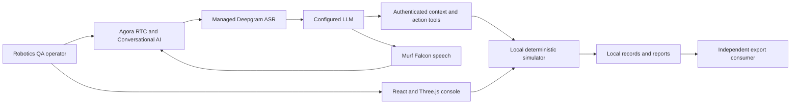

# RoboTrace

**A voice-operated robotics sandbox, QA console and evidence handoff for household robotics teams.**

Tell the robot what to do, watch the actual plan and motion, interrupt it, and inspect the resulting recording. RoboTrace runs entirely on a laptop; no robot hardware is required. Its intended operator is a robotics data or evaluation engineer collecting reproducible task traces and investigating failures before physical testing.

The main workspace is a persistent mobile kitchen. Cup, Bowl, Counter, Table, Sink and Home retain their state between tasks. Natural language describes the requested action; the controller checks routes, reach, cargo custody and task outcomes. Completion and task acceptance are separate results.

## What works

- **Voice-first operation:** Agora Conversational AI and RTC carry the conversation; Murf Falcon supplies speech. Live captions show both speakers. Freeform instructions are interpreted against the current scene before entering the controller; the sandbox has no object/destination form or text-entry box.
- **Distinct robot primitives:** “Go to Sink” navigates only. “Pick up cup” collects and holds it. “Carry cup to Sink” arrives without releasing it. “Place cup at Sink” releases it. These requests do not silently become a default collection assignment.
- **A changing sandbox:** queue multiple tasks, reposition a software person proxy or movable floor block, and observe actual detours or blocked motion. Blocked tasks require explicit recovery; stop preserves held cargo.
- **A durable QA console:** run declared baseline, human-authored or explicit LLM symbolic candidates against frozen conditions. Local evaluation history survives reloads and supports reopening actual trajectories. Unrun comparisons remain empty.
- **Evidence and independent analysis:** save native recordings with a SHA-256 seal and independently recomputed recorded-state checks; reopen, replay and export them. One-click saves remain **Unreviewed**. A standalone consumer and browser viewer inspect exported states without the application API.
- **Workcell environments and scene authoring:** repair-kit, household and sample-routing tasks have retrievable locally authored SOPs. Text, a photo or one selected video frame can propose a bounded scene for operator review. Seeded variations preserve declared parent-scene lineage.

## Run locally

```sh
git clone git@github.com:dipakkr/robotrace.git
cd robotrace
npm install
cp .env.example .env.local
```

For live voice, fill the ignored `.env.local` with `AGORA_APP_ID`, `AGORA_APP_CERTIFICATE`, `MURF_API_KEY` and `LLM_API_KEY`. Follow the [account checklist](docs/ACCOUNT_SETUP_CHECKLIST.md) and [server setup](server/SETUP.md). Enable Agora Conversational AI for the project. Customer ID and Secret are optional: the server can authenticate Agora REST requests using the App Certificate.

Use Node.js 24 (recommended), or a compatible version with `--env-file-if-exists` support. The full launcher also needs the `cloudflared` executable:

```sh
npm run demo:start
npm run demo:status
npm run doctor -- --check --health
```

Open **[http://127.0.0.1:5189/kitchen](http://127.0.0.1:5189/kitchen)** for the Free Kitchen Navigation Environment. Voice connects automatically after the scene is ready; allow microphone access when the browser requests it. The root route contains the workcell and evaluation tools. The UI uses loopback port **5189**, the local API **8787**, and a public HTTPS tunnel exposes authenticated tool callbacks on **8788**. Agora needs that reachable HTTPS callback; a localhost URL cannot serve its remote tool requests. The launcher maintains `PUBLIC_API_BASE_URL` when starting a new tunnel and tracks project-owned processes in ignored `.local/`.

```sh
npm run demo:restart-api  # Reload server changes; reconnect voice afterward
npm run demo:stop         # Stop only verified project-owned processes
```

For local simulation without a tunnel or live voice, use two terminals:

```sh
npm run server
npm run dev -- --host 127.0.0.1 --port 5189 --strictPort
```

The local controller, baseline evaluations and offline analysis do not require a model call. The live voice sandbox requires its configured voice services. Freeform interpretation, AI scene drafting and AI candidate generation require the configured LLM and are explicit provider requests. These are not unlimited offline features.

## A three-minute demonstration

| Time | Show | What it establishes |
| --- | --- | --- |
| 0:00–0:50 | Click **Start simulation** (or open `/kitchen`), allow microphone access, and ask “Pick up cup and go to sink.” Then ask “Place cup at sink.” | The base moves into reach; pickup, held transport and release are distinct. The terminal shows returned plans and verified events. |
| 0:50–1:20 | Request another transfer. Use **Human enters** during travel, or **Block destination**, then clear the person and explicitly resume. | A clear detour can continue; a genuinely blocked route pauses. This is a software scenario, not physical safety certification. |
| 1:20–1:45 | Click **Save mobile evidence**. Open **Saved recordings**, replay the saved trace, export it and return to live. | A real local record and report survive independently of the current scene. Saving does not assert human quality approval. |
| 1:45–3:00 | Open **QA console → Run matched regression pair**, export the comparison and load it in **Trace analysis**. | Both plans can deliver Cup while one moves and restores the protected Bowl. Recorded history catches the violation despite identical final Bowl state. |

Use [the detailed runbook](docs/DEMO_SCRIPTS.md), [QA guide](docs/QA_DEMO.md) and [regression workflow](docs/REGRESSION_WORKFLOW.md) for preparation. The independent viewer is available at [localhost Trace analysis](http://127.0.0.1:5189/trace-analysis.html); its downloaded report works offline.

## Architecture and track fit



The workplace workflow is **request → retrieve current scene/SOP → execute meaningful simulation actions → communicate checked outcomes → persist a report and follow-up evidence**. This fits an employee copilot for robotics data and evaluation operations. The SOPs, assignments and record store are real local application data; they are not an external enterprise connector or a frontier-lab partnership. See the [hackathon positioning](docs/HACKATHON_POSITIONING.md) and [final judging checklist](docs/FINAL_JUDGING.md). The matrix records our interpretation of the track, not an official score.

## Data another program can inspect

Native exports contain recorded world states, task outcomes, control interventions and the derived joint/link/TCP coordinates used by the renderer. The consumer uses Node built-ins:

```sh
node scripts/consume-evidence.mjs INPUT.teachtrace.json --out .local/consumer/run-1
```

For native recordings it verifies integrity and additive forward kinematics, then writes observations, **next-observed-state targets** and a manifest. For supported mobile comparisons it also produces `protected-analysis.json` and a standalone `report.html`. These targets are observed simulator states, not requested motor commands or calibrated training actions.

Related workcell variants retain a declared common parent fingerprint, seed, index and variation kind. This supports grouping correlated scenes; upstream identity is unverified and no train/test split is performed. Live operator layout interventions are disclosed rather than presented as frozen matched conditions. See [the consumer contract](docs/DATA_CONSUMER.md) and [data strategy](docs/DATA_FLYWHEEL_STRATEGY.md).

The existing `teachtrace.*` native schema identifiers and `.teachtrace.json` evidence format are retained for compatibility. **RoboTrace** is the application name; renaming the product does not rewrite historical evidence or invalidate its seal.

## Verification and voice status

```sh
npm test
npm run build
node scripts/kitchen-route-smoke.mjs  # isolated auto-connect lifecycle; paid starts intercepted
```

[Validation](docs/VALIDATION.md) lists observed checks, artifacts and open acceptance gates. The `/kitchen?voice=off` URL is an explicit opt-out for development checks; ordinary `/kitchen` entry automatically connects voice. Browser scripts that start real voice sessions make provider requests. Some older recorded demonstrations and smoke scripts reflect earlier UI revisions; use the current route and speech-control checks for the voice-only interface. Automated checks exercise actual controller motion, failure cases, report persistence, protected-object history, integrity and independent analysis. [Feature acceptance](docs/FEATURE_ACCEPTANCE.md) and [the task backlog](docs/DELIVERY_BACKLOG.md) distinguish implemented behavior from remaining work.

Real-provider rehearsals have exercised Agora/Murf audio, action tools, completed mobile tasks, saved reports and spoken outcomes using prerecorded input. A real freeform LLM browser check also executed Cup → Sink → Table with two separate native recordings and preserved Bowl throughout. Prerecorded automation is **not** a person's microphone/speaker acceptance test; that gate remains open.

ASR is configured for Deepgram Nova-3 multilingual input, including Hindi, Hinglish and English. The existing Murf voice remains configured for English replies. The combined prerecorded-input live check passed navigation → Hindi Stop → Hindi pickup → held carrying to Sink without release. Hindi recognition produced some mixed-script phonetic errors that the grounded LLM resolved in that run; recognition accuracy is not guaranteed. The observed Hindi Stop transcript-to-acknowledgment time was about 2.1 seconds, not microphone-to-stop latency. Strict direct Stop handling is tested separately and was not observed for that garbled Hindi transcript. [Deepgram documents multilingual code-switching](https://developers.deepgram.com/docs/nova-3-language-prompting); [Murf lists Matthew as an English voice](https://murf.ai/api/docs/voices-styles/voice-library). We do not claim Hindi speech output is configured.

## Security and limits

Keep secrets only in ignored `.env.local`; never use `VITE_` variables for provider credentials. Provider calls stay on the Node server. Tool callbacks use per-session bearer credentials, local files are private, and the launcher checks ownership before stopping processes. The public callback tunnel exposes the tools listener, not the full local API. These controls do not establish production security or multi-user isolation.

The hosted preview is a static frontend. Full voice, persistence and provider workflows require the running local backend and callback tunnel. This is a bounded working prototype, not a production cloud robotics platform.

Motion uses known-map routing, analytic kinematics and idealized attachment grasps. It does not provide SLAM, contact dynamics, measured forces, full arm collision checking or validated physical safety. Photo and selected-frame scene drafting currently targets the workcell templates. Photo import into the mobile kitchen is not implemented; no calibrated room reconstruction or recovered human motion is claimed. No model-training gain, LeRobot/RLDS compatibility, recipient ingestion or real-robot transfer is claimed.

Research and design context: [Physical AI research](docs/PHYSICAL_AI_RESEARCH.md), [evaluation perspective](docs/PHYSICAL_AI_EVALUATIONS.md), [Indian kitchen references](docs/INDIAN_KITCHEN_REFERENCES.md), [human demonstration bridge](docs/HUMAN_DEMONSTRATION_BRIDGE.md), and [control-system design references](docs/DESIGN_REFERENCES.md).
