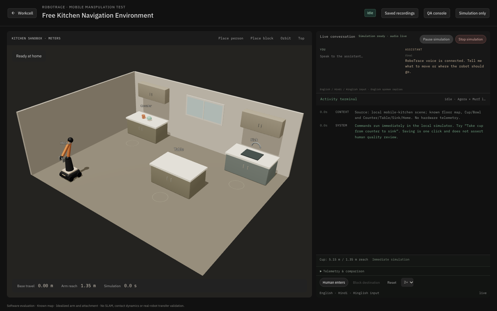
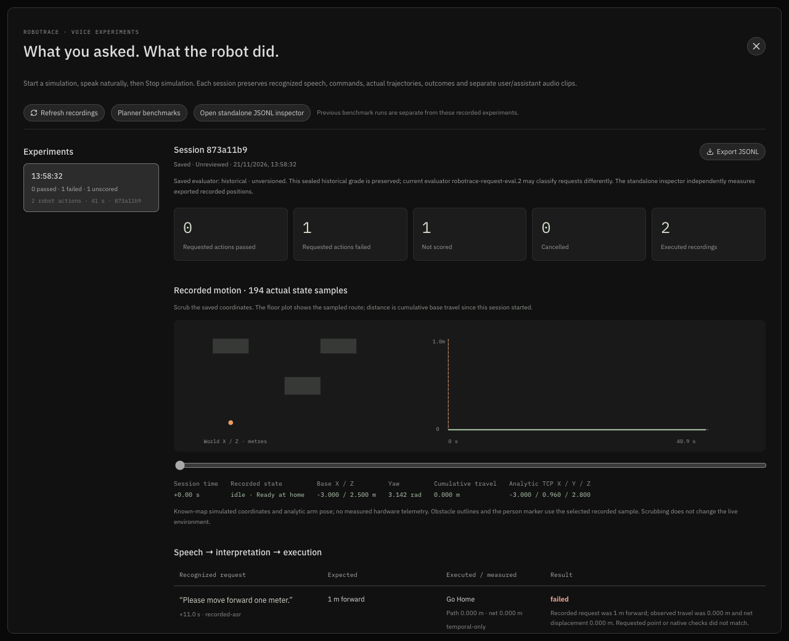
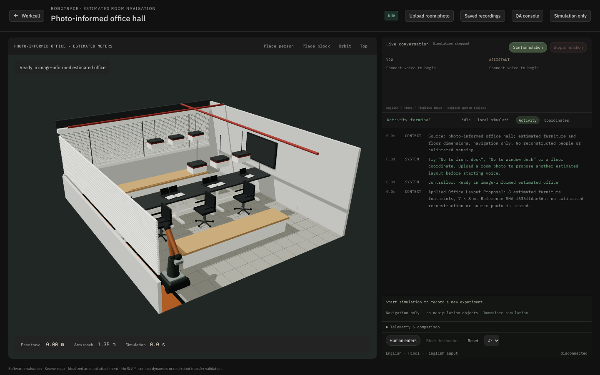
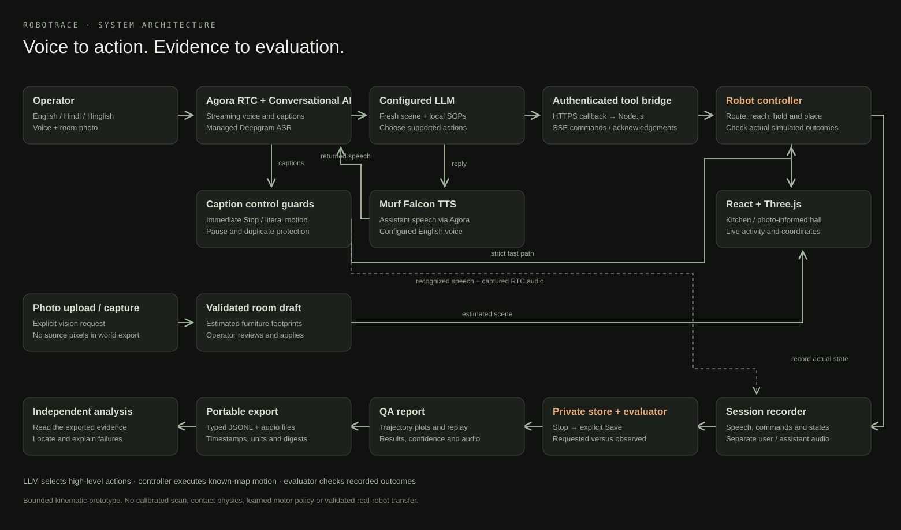
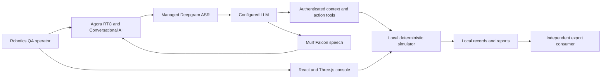
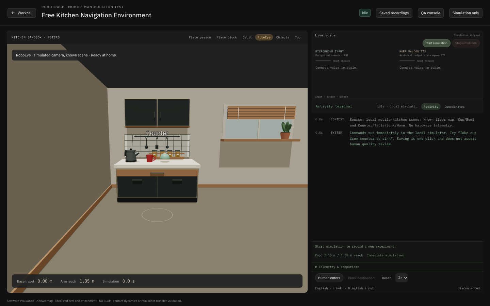

# RoboTrace

**A voice-operated robotics sandbox, QA console and evidence handoff for household robotics teams.**

Tell the robot what to do, watch the actual plan and motion, interrupt it, and inspect the resulting recording. RoboTrace runs entirely on a laptop; no robot hardware is required. Its intended operator is a robotics data or evaluation engineer collecting reproducible task traces and investigating failures before physical testing.

The main workspace is a persistent mobile kitchen. Cup, Bowl, Counter, Table, Sink and Home retain their state between tasks. Natural language describes the requested action; the controller checks routes, reach, cargo custody and task outcomes. Completion and task acceptance are separate results.

## Watch the demo







- **[Voice action → Stop → Save → QA, with real captured user/assistant audio — 48-second demo](https://github.com/dipakkr/robotrace/blob/main/docs/media/robotrace-voice-experiment.mp4)**
- **[English/Hindi navigation, Stop, pickup and held carrying — 73-second recorded demo](https://github.com/dipakkr/robotrace/blob/main/docs/media/robotrace-english-hindi-demo.mp4)**
- **[Quiet listening, Pause/Resume, and Stop without leaving the kitchen — 41-second recorded demo](https://github.com/dipakkr/robotrace/blob/main/docs/media/robotrace-session-controls.mp4)**

These are actual application recordings from real Agora/Murf sessions using prerecorded microphone input. The first (whole-session QA) video includes the actual captured microphone and assistant tracks with **approximate wall-clock alignment**, not sample synchronization. The two earlier videos show the screen/captions; their verified remote audio is not mixed in. The English/Hindi clip shows an earlier control layout; the kitchen screenshot, whole-session demo and quiet-listening clip show consolidated session controls. Videos can be opened or downloaded from their repository file pages.

## What works

- **Voice-first operation:** Agora Conversational AI and RTC carry the conversation; Murf Falcon supplies speech. Live captions show both speakers. Freeform instructions are interpreted against the current scene before entering the controller; the sandbox has no object/destination form or text-entry box.
- **Distinct robot primitives:** “Go to Sink” navigates only. “Pick up cup” collects and holds it. “Carry cup to Sink” arrives without releasing it. “Place cup at Sink” releases it. These requests do not silently become a default collection assignment.
- **A changing sandbox:** queue multiple tasks, reposition a software person proxy or movable floor block, and observe actual detours or blocked motion. Blocked tasks require explicit recovery; stop preserves held cargo.
- **Whole-session recording and QA:** Start records both speakers’ recognized speech, separate microphone/assistant audio, requested commands, controller events, sampled coordinates and native task traces. Stop opens a save dialog. **Save & view report** compares the recorded request with actual movement and handling; a successful wrong task still fails. Saved sessions reopen after reload.
- **Inspect the motion:** Activity and Coordinates tabs show current base/arm pose, route and person clearance. The saved report provides measured distance, request/action association confidence, coordinate scrubbing, native 3D replay, audio playback and JSONL export.
- **Planner benchmarks:** separately run declared baseline, human-authored or explicit LLM symbolic candidates against frozen conditions. Unrun comparisons remain empty; authored negative examples are labelled.
- **Evidence and independent analysis:** save native recordings with a SHA-256 seal and independently recomputed recorded-state checks; reopen, replay and export them. One-click saves remain **Unreviewed**. A standalone consumer and browser viewer inspect exported states without the application API.
- **Workcell environments and scene authoring:** repair-kit, household and sample-routing tasks have retrievable locally authored SOPs. Text, a photo or one selected video frame can propose a bounded scene for operator review. Seeded variations preserve declared parent-scene lineage.

## Run locally

```sh
git clone git@github.com:dipakkr/robotrace.git
cd robotrace
npm install
cp .env.example .env.local
```

For live voice, fill the ignored `.env.local` with `AGORA_APP_ID`, `AGORA_APP_CERTIFICATE`, `MURF_API_KEY` and `LLM_API_KEY`. Follow the [account checklist](docs/ACCOUNT_SETUP_CHECKLIST.md) and [server setup](server/SETUP.md). Enable Agora Conversational AI for the project. Customer ID and Secret are optional: the server can authenticate Agora REST requests using the App Certificate.

Use Node.js 24 (recommended), or a compatible version with `--env-file-if-exists` support. The full launcher also needs the `cloudflared` executable:

```sh
npm run demo:start
npm run demo:status
npm run doctor -- --check --health
```

Open **[http://127.0.0.1:5189/kitchen](http://127.0.0.1:5189/kitchen)** for the Free Kitchen Navigation Environment. Voice connects automatically after the scene is ready; allow microphone access when the browser requests it. The root route contains the workcell and evaluation tools. The UI uses loopback port **5189**, the local API **8787**, and a public HTTPS tunnel exposes authenticated tool callbacks on **8788**. Agora needs that reachable HTTPS callback; a localhost URL cannot serve its remote tool requests. The launcher maintains `PUBLIC_API_BASE_URL` when starting a new tunnel and tracks project-owned processes in ignored `.local/`.

```sh
npm run demo:restart-api  # Reload server changes; reconnect voice afterward
npm run demo:stop         # Stop only verified project-owned processes
```

For local simulation without a tunnel or live voice, use two terminals:

```sh
npm run server
npm run dev -- --host 127.0.0.1 --port 5189 --strictPort
```

The local controller, baseline evaluations and offline analysis do not require a model call. The live voice sandbox requires its configured voice services. Freeform interpretation, AI scene drafting and AI candidate generation require the configured LLM and are explicit provider requests. These are not unlimited offline features.

## A three-minute demonstration

The decision: **“Did the robot do what I asked, and can another engineer investigate the failures?”**

| Time | Show | What it establishes |
| --- | --- | --- |
| 0:00–0:25 | Open `/kitchen`; allow the microphone. Say **“Move forward one meter.”** Open **Coordinates**. | Real Agora/Murf conversation and actual measured base motion. Questions such as “How far is the Counter?” do not authorize movement. |
| 0:25–1:05 | Say **“Go to Counter”**, **“Pick up the red cup”**, then **“Carry cup to Sink.”** Place/move the person during travel. | Navigation, pickup and held carrying remain distinct. The controller reroutes when a clear alternate path exists and pauses if none does. |
| 1:05–1:25 | Say **“Place cup at Sink.”** If time permits, request an impossible straight movement such as **“Go straight six meters.”** | Explicit release is required. The current relative controller limit is 5 m: a 6 m request is refused, not silently shortened or marked successful. This is a declared capability limit, not by itself a planner defect. |
| 1:25–1:45 | Click **Stop simulation → Save & view report**. | Voice closes and the scene stays on `/kitchen`. The entire session, actual commands, states and separate audio clips are persisted. Saving remains Unreviewed. |
| 1:45–2:25 | Show requested-versus-observed rows, coordinate/time scrubber, a failed request, and native replay/audio. | Native completion does not override the user’s requested goal. Clear refusals and no-action requests remain visible; unclear speech stays unscored. |
| 2:25–3:00 | Export JSONL and load it into **[Voice experiment analysis](http://127.0.0.1:5189/voice-experiment-analysis.html)**. | A separate program reads actual exported samples, plots positions/displacement, and checks bounded relative requests without the application API. |

A useful regression example was discovered during development: the real voice model mapped “Please move forward one meter” to **Go Home**, completing its chosen zero-distance task. The session report correctly failed the requested 1 m action. The original failed record is retained separately from subsequent fixes and rehearsals. Do not describe a hardcoded negative candidate as a newly discovered model error.

Optional second scene: **[Photo-informed hall](http://127.0.0.1:5189/hall)** is a photo-informed office navigation prototype. Upload/camera drafting proposes bounded furniture footprints and estimated dimensions; review and apply the room before Start simulation. This is an editable estimate, **not a calibrated scan**. No original room photos or identifiable people are included in the repository.

Advanced planner comparisons remain under **Planner benchmarks**. The matched protected-Bowl example demonstrates why final pose alone can conceal a violation. Keep that frozen comparison separate from a judge’s live, differently timed intervention.

## Architecture and track fit

See the [full architecture diagram and component responsibilities](docs/ARCHITECTURE.md).





The workplace workflow is **request → retrieve current scene/SOP → execute meaningful simulation actions → communicate checked outcomes → persist a report and follow-up evidence**. This fits an employee copilot for robotics data and evaluation operations. The SOPs, assignments and record store are real local application data; they are not an external enterprise connector or a frontier-lab partnership. See the [hackathon positioning](docs/HACKATHON_POSITIONING.md), [final judging checklist](docs/FINAL_JUDGING.md), and [provisional assessment against the supplied rubric](docs/RUBRIC_ASSESSMENT.md). The visible rubric totals 95 despite a /100 interface; our working estimate is not a judge's score.

## Data another program can inspect

Native exports contain recorded world states, task outcomes, control interventions and the derived joint/link/TCP coordinates used by the renderer. The consumer uses Node built-ins:

```sh
node scripts/consume-evidence.mjs INPUT.teachtrace.json --out .local/consumer/run-1
```

For native recordings it verifies integrity and additive forward kinematics, then writes observations, **next-observed-state targets** and a manifest. For supported mobile comparisons it also produces `protected-analysis.json` and a standalone `report.html`. These targets are observed simulator states, not requested motor commands or calibrated training actions.

Related workcell variants retain a declared common parent fingerprint, seed, index and variation kind. This supports grouping correlated scenes; upstream identity is unverified and no train/test split is performed. Live operator layout interventions are disclosed rather than presented as frozen matched conditions. See [the consumer contract](docs/DATA_CONSUMER.md) and [data strategy](docs/DATA_FLYWHEEL_STRATEGY.md).

The existing `teachtrace.*` native schema identifiers and `.teachtrace.json` evidence format are retained for compatibility. **RoboTrace** is the application name; renaming the product does not rewrite historical evidence or invalidate its seal.

## Verification and voice status

```sh
npm test
npm run build
node scripts/kitchen-route-smoke.mjs  # isolated auto-connect lifecycle; paid starts intercepted
```

[Validation](docs/VALIDATION.md) lists observed checks, artifacts and open acceptance gates. The `/kitchen?voice=off` URL is an explicit opt-out for development checks; ordinary `/kitchen` entry automatically connects voice. Browser scripts that start real voice sessions make provider requests. Some older recorded demonstrations and smoke scripts reflect earlier UI revisions; use the current route and speech-control checks for the voice-only interface. Automated checks exercise actual controller motion, failure cases, report persistence, protected-object history, integrity and independent analysis. [Feature acceptance](docs/FEATURE_ACCEPTANCE.md) and [the task backlog](docs/DELIVERY_BACKLOG.md) distinguish implemented behavior from remaining work.

Real-provider rehearsals have exercised Agora/Murf audio, action tools, completed mobile tasks, saved reports and spoken outcomes using prerecorded input. A real freeform LLM browser check also executed Cup → Sink → Table with two separate native recordings and preserved Bowl throughout. Prerecorded automation is **not** a person's microphone/speaker acceptance test; that gate remains open.

Input recognition uses Deepgram Nova-3 multilingual ASR, including Hindi, Hinglish and English. The existing Murf voice remains configured for English replies. The combined prerecorded-input live check passed navigation → Hindi Stop → Hindi pickup → held carrying to Sink without release. Hindi recognition produced some mixed-script phonetic errors that the grounded LLM resolved in that run; recognition accuracy is not guaranteed. The observed Hindi Stop transcript-to-acknowledgment time was about 2.1 seconds, not microphone-to-stop latency. Strict direct Stop handling is tested separately and was not observed for that garbled Hindi transcript. [Deepgram documents multilingual code-switching](https://developers.deepgram.com/docs/nova-3-language-prompting); [Murf lists Matthew as an English voice](https://murf.ai/api/docs/voices-styles/voice-library). We do not claim Hindi speech output is configured.

## Security and limits

Keep secrets only in ignored `.env.local`; never use `VITE_` variables for provider credentials. Provider calls stay on the Node server. Tool callbacks use per-session bearer credentials, local files are private, and the launcher checks ownership before stopping processes. The public callback tunnel exposes the tools listener, not the full local API. These controls do not establish production security or multi-user isolation.

The hosted preview is a static frontend. Full voice, persistence and provider workflows require the running local backend and callback tunnel. This is a bounded working prototype, not a production cloud robotics platform.

Motion uses known-map routing, analytic kinematics and idealized attachment grasps. It does not provide SLAM, contact dynamics, measured forces, full arm collision checking or validated physical safety. Photo and selected-frame drafting support bounded workcell templates; the separate photo-informed hall proposes an estimated navigable furniture layout. It does not infer calibrated dimensions, reconstruct detailed meshes, recover human motion, or turn an arbitrary image into a physics-validated kitchen. No model-training gain, LeRobot/RLDS compatibility, recipient ingestion or real-robot transfer is claimed.

Research and design context: [Physical AI research](docs/PHYSICAL_AI_RESEARCH.md), [evaluation perspective](docs/PHYSICAL_AI_EVALUATIONS.md), [Indian kitchen references](docs/INDIAN_KITCHEN_REFERENCES.md), [human demonstration bridge](docs/HUMAN_DEMONSTRATION_BRIDGE.md), and [control-system design references](docs/DESIGN_REFERENCES.md).

## Share a robotics evaluation report



Open a saved experiment in **QA console → Open evaluation report**. The standalone report includes initial planned and recorded routes, furniture/person proxies, measured travel, task checks, request-versus-observed outcomes and evidence metadata. **Download report** saves portable HTML; its Print button supports Save as PDF. **Evaluation JSON** provides the derived machine-readable report. Historical grades and original evidence seals are preserved. This evaluates task-level kinematic behavior, not learned motor-policy performance or physical safety.

The kitchen now exposes **Objects** for known scene inventory, including the rendered kettle, canisters, utensils, plates and plant. Fixed visual items are identifiable but not graspable; Cup and Bowl remain movable. **RoboEye** switches to a simulated camera at the robot’s current pose. Its image is rendered from the known scene, not camera perception. Microphone/ASR and Murf Falcon via Agora panels show both actual transcript streams and SDK audio activity.
