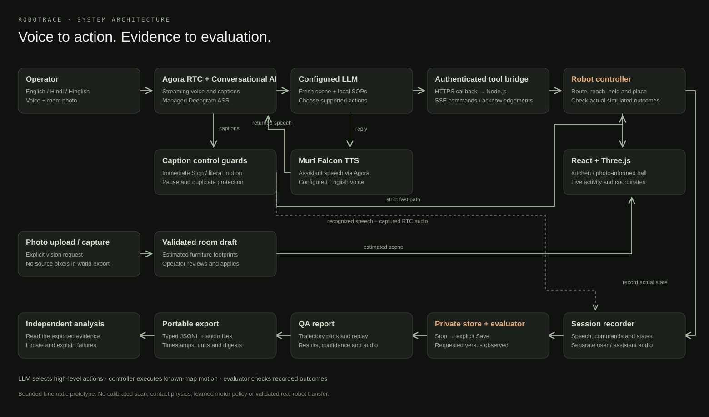
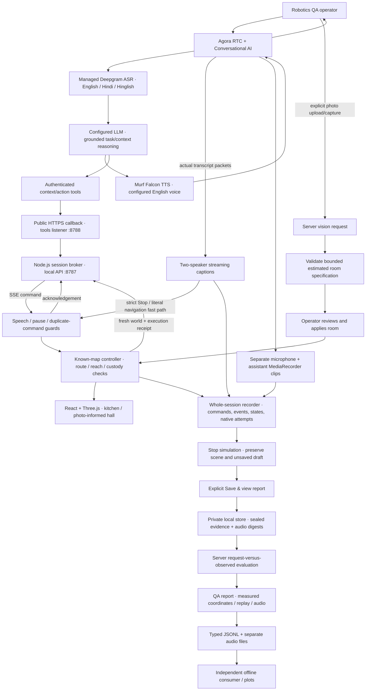

# RoboTrace architecture

RoboTrace evaluates a voice-to-action robotics workflow in a bounded simulator. The LLM chooses supported high-level actions; the browser controller computes routes, executes motion and checks outcomes. Murf Falcon supplies the conversational speech through Agora.

## Responsibilities

| Layer | Implementation | Responsibility |
| --- | --- | --- |
| Operator UI | React, TypeScript, Three.js / React Three Fiber | Kitchen/hall routes, voice status, live captions/activity/coordinates, person/block controls, scene and replay |
| Conversation | Agora Conversational AI and Agora RTC | Microphone and returned speech transport, multilingual ASR, configured LLM, actual transcript events |
| Speech output | Murf Falcon, configured through Agora | English speech output; Hindi/Hinglish input does not imply a Hindi TTS voice |
| Decision/action boundary | `voice-command-parser.ts`, pause guard, authenticated tools | Preserve literal supported requests, immediate Stop, reject conflicting duplicate actions, keep questions from becoming motion |
| Controller | `mobile-navigation.ts`, `mobile-arm.ts` | Known-map routing, explicit pickup/hold/place semantics, dynamic person/block response, analytic pose and task checks |
| Knowledge/context | `task-guides.mjs`, fresh world and navigation distances | Locally authored procedures and actual visible labels/state; no external enterprise connector or vector database is implied |
| Photo authoring | `room-draft.mjs`, `PhotoRoomBuilder.tsx`, `photo-hall.ts` | Explicit vision request, validated estimated footprints and operator apply; not calibrated reconstruction |
| Recording/evaluation | `useVoiceExperiment.ts`, `voice-experiment.ts`, `experiment-store.mjs` | Preserve original observations; grade the recognized request against observed motion, retain ambiguity and historical grading revisions |
| Data handoff | JSONL, native trace exports, offline HTML/CLI consumers | Inspect states/failures independently, retain timestamps, units, provenance and integrity |

## Important data paths

1. **Normal agent action:** voice → ASR → LLM → context/action tool → authenticated callback → SSE → browser controller → acknowledgement → checked outcome → spoken response.
2. **Fast bounded control:** actual caption → strict literal parser → controller. A matching later model tool is deduplicated; its response refreshes the same native mission’s actual result. Free instructions still use the agent/tool path.
3. **Save and QA:** Stop flushes audio and creates a browser draft. An explicit save persists the experiment, then uploads separate audio clips. The server computes its own report; it does not accept a posted grade.
4. **Photo to room:** explicit image request → bounded estimated specification → review/apply → generated geometry used by rendering and routing. Source pixels and identifiable people are not embedded in exported worlds.

## Scope and deployment

The complete demo runs on a laptop: UI `127.0.0.1:5189`, private API `8787`, tools listener `8788`. The public HTTPS tunnel exposes authenticated tool callbacks; it does not publish the private record API. Provider secrets stay in ignored `.env.local` on the server.

These are simulated known-map trajectories and analytic arm coordinates, with idealized grasps. No SLAM, contact dynamics, measured motor telemetry, learned low-level policy, calibrated room scan or demonstrated real-robot transfer is claimed. The current value is language/action QA, reproducible failure investigation and regression evidence.
